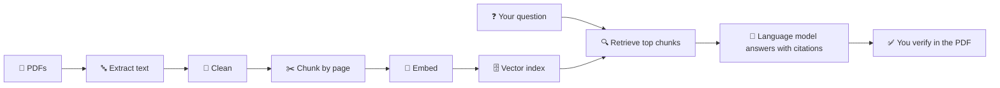

<div align="center">

# 🏭 Tormach Documentation Library 📚

### Learn it 🧠 · Make it 🛠 · Share it 🤝

**A community-maintained archive of PDF manuals, installation instructions and reference documents from [tormach.com](https://tormach.com/), organised in one place for education, self-study, AI-assisted learning and everyday shop use.**


[🚀 Quick Start](#-quick-start) · [🎁 Benefits](#-benefits-of-these-documents) · [📖 How to Use](#-how-to-use-these-docs-step-by-step) · [🤖 AI Guide](#-using-these-docs-with-ai) · [🌱 Roadmap](#-improve-yourself-a-learning-roadmap) · [🤝 Community](#-improve-your-community)

</div>

---

## 🧭 Table of Contents

1. [⚡ At a Glance](#-at-a-glance)
2. [🚀 Quick Start](#-quick-start)
3. [🚨 Important Notice (Read First)](#-important-notice-read-first)
4. [🏢 About Tormach](#-about-tormach)
5. [📁 Repository Structure](#-repository-structure)
6. [📚 What the Documentation Covers](#-what-the-documentation-covers)
7. [🎁 Benefits of These Documents](#-benefits-of-these-documents)
8. [🔎 How to Find the Right Document](#-how-to-find-the-right-document)
9. [📖 How to Use These Docs (Step by Step)](#-how-to-use-these-docs-step-by-step)
10. [🦺 Shop Safety Essentials](#-shop-safety-essentials)
11. [🤖 Using These Docs With AI](#-using-these-docs-with-ai)
12. [🌱 Improve Yourself: A Learning Roadmap](#-improve-yourself-a-learning-roadmap)
13. [🤝 Improve Your Community](#-improve-your-community)
14. [🎓 For Teachers, Schools and Training Programs](#-for-teachers-schools-and-training-programs)
15. [👥 Who Can Use This Repository](#-who-can-use-this-repository)
16. [🧠 Glossary of CNC Terms](#-glossary-of-cnc-terms)
17. [💾 Download and Clone](#-download-and-clone)
18. [🧰 Helper Scripts](#-helper-scripts)
19. [🛠 Contributing](#-contributing)
20. [🔄 Keeping the Library Up to Date](#-keeping-the-library-up-to-date)
21. [❓ FAQ](#-faq)
22. [🔗 Useful Official Links](#-useful-official-links)
23. [📜 License and Disclaimer](#-license-and-disclaimer)

---

## ⚡ At a Glance

| 🏷 Item                      | 📋 Details                                                                                                                     |
| ---------------------------- | ------------------------------------------------------------------------------------------------------------------------------ |
| **What this is**             | A collection of documentation PDFs taken from the Tormach website                                                              |
| **Where the PDFs live**      | The `PDFs/` folder at the root of this repository 📂                                                                           |
| **Source website**           | 🌐 <https://tormach.com/>                                                                                                      |
| **Official document search** | 🔍 <https://tormach.com/docs>                                                                                                  |
| **Main topics**              | CNC mills, lathes, routers, bandsaws, plasma tables, robots, tooling, workholding, upgrades, PathPilot software                |
| **Best for**                 | 🎓 Students, 👩‍🏫 teachers, 🛠 makers, 🧑‍🏭 machinists, 💼 shop owners, 🔬 researchers, 🤖 AI builders                             |
| **Cost**                     | 💸 Free to read, download and share (see the [license notice](#-license-and-disclaimer) for what that does and does not cover) |
| **Repo license**             | MIT (applies to this repository's own files, not to Tormach's documents)                                                       |

> [!TIP]
> **In one sentence:** this repository puts the practical knowledge behind affordable CNC machining into one searchable, downloadable, offline-friendly place so more people can learn it, teach it and use it. ✨

---

## 🚀 Quick Start

Get value from this library in under five minutes:

| Step | Action                                                                                      | Time   |
| ---- | ------------------------------------------------------------------------------------------- | ------ |
| 1️⃣   | **Open** the [`PDFs/`](PDFs/) folder                                                        | 10 sec |
| 2️⃣   | **Press `t`** on the repository page and type a keyword such as `lathe`, `1100` or `collet` | 20 sec |
| 3️⃣   | **Read the safety sections first** (always 🦺), then the procedure                          | 5 min  |
| 4️⃣   | **Verify** anything safety-critical on the official site: <https://tormach.com/docs>        | 2 min  |
| 5️⃣   | **Share** the repo with a friend, class or makerspace 🤝                                    | 10 sec |

**Want to go further?**

- 🤖 Feed the PDFs to an AI study assistant → [AI guide](#-using-these-docs-with-ai)
- 📅 Follow a structured 90-day plan → [Learning roadmap](#-improve-yourself-a-learning-roadmap)
- 🎓 Teaching a class? → [Teacher resources](#-for-teachers-schools-and-training-programs)

---

## 🚨 Important Notice (Read First)

> [!WARNING]
> Please read all five points below before using or sharing anything in this repository.

1. 🏷 **This is an unofficial archive.** It is not run, endorsed or sponsored by Tormach Inc. "Tormach" and "PathPilot" are trademarks of Tormach Inc.
2. ©️ **The documents belong to Tormach.** The PDFs are copyrighted by their original owner. The MIT license in this repository covers only the files written by the repository owner (this README, scripts and similar), **not** the Tormach PDFs themselves.
3. ✅ **Always check the official source.** Manuals get corrected and revised. Before you rely on a procedure for safety-critical work, confirm you have the latest version at <https://tormach.com/docs> or in the [Tormach Knowledge Base](https://knowledgebase.tormach.com/).
4. 🦺 **Documentation does not replace training.** CNC machines can cause serious injury. Reading a manual is not the same as being trained on a machine. Use proper personal protective equipment, follow your instructor's or employer's safety rules, and get hands-on instruction from a qualified person.
5. 📬 **If Tormach asks for removal,** the owner of this repository should remove the requested files promptly.

---

## 🏢 About Tormach

Tormach is a US-based manufacturer of CNC machines and automation tools. According to the company's website, its stated focus is on machines that are **capable 💪, affordable 💰 and easy to use 🙂**. The points below come from the information published on tormach.com.

### 🔑 Key facts from the Tormach website

| Topic                                   | What the website says                                                                                                                  |
| --------------------------------------- | -------------------------------------------------------------------------------------------------------------------------------------- |
| ⚡ **Power**                            | The full line runs on **single-phase power**, so you do not need expensive industrial three-phase power                                |
| 🔩 **Materials**                        | Machines are described as able to cut **wood, plastics, aluminum, steel and titanium**                                                 |
| 🖥 **Control software**                 | **PathPilot®**, described as free, open-source, easy to learn, with **free updates for life**                                          |
| 🎮 **Learning PathPilot**               | A virtual **PathPilot HUB** is available with a free account and an internet connection                                                |
| 📈 **Upgradability**                    | Machines are designed to be **upgradable and self-serviceable**; for example you can add an automatic tool changer or a 4th axis later |
| 🔓 **Ownership**                        | "True ownership": no service contracts and no software lockouts                                                                        |
| 🇺🇸 **Support**                          | US-based pre-sales and technical support teams                                                                                         |
| 🧑‍🤝‍🧑 **Company culture**                  | The site logo states the company is 100% employee owned                                                                                |
| 📍 **Headquarters**                     | Madison, Wisconsin, USA                                                                                                                |
| ☎️ **Phone**                            | (608) 849-8381                                                                                                                         |
| 🏛 **Organisations named as customers** | NASA, the US Navy, Oak Ridge National Laboratory (ORNL), GE, Ohio State University and Subaru                                          |

### 🏗 Product families listed on the website

| Category              | Models listed                                                                                                                                                               |
| --------------------- | --------------------------------------------------------------------------------------------------------------------------------------------------------------------------- |
| 🔧 **CNC Mills**      | 1500MX, 1100MX, 770MX, 1100M, 770M, PCNC 440                                                                                                                                |
| 🪚 **CNC Routers**    | 24R CNC Router, xsTECH Pro Router, xsTECH Router                                                                                                                            |
| 🌀 **CNC Lathes**     | 15LX, 15L, 8L                                                                                                                                                               |
| 🤖 **Other machines** | Bandsaws, Robots (for example the ZA6), Plasma tables (for example the 1300PL), Automation solutions                                                                        |
| 🎓 **Education**      | Education Bundles (machine packages for schools) and the NC3 curriculum for the xsTECH CNC router                                                                           |
| ⬆️ **Upgrades**       | Upgrade options for mills (including 1100M+, 770M+ and older PCNC 1100 / 770 / 440), lathes, routers, plasma tables, robots, rotary tables / RapidTurn and CAD/CAM software |
| 🧰 **Tooling**        | Cutting tools, toolholding, workholding, plasma consumables and sources, probes and metrology                                                                               |

> [!NOTE]
> Model lists change over time. Treat the tables above as a snapshot taken from the website at the time this README was written.

---

## 📁 Repository Structure

```text
📦 tormach-com-documentation/
├── 📂 PDFs/               <- all documentation PDFs live here
├── 📂 scripts/            <- optional helper scripts (index builder, text extractor)
├── 📄 INDEX.md            <- optional auto-generated list of every PDF
├── 🙈 .gitignore
├── ⚖️ LICENSE             <- MIT license for the repository's own files
└── 📘 README.md           <- this file
```

> [!TIP]
> **Tips for the `PDFs/` folder**
>
> - 🏷 Keep original file names whenever possible, because Tormach file names often contain the product or part number you will search for later.
> - 🗂 If you add sub-folders, group by product family (for example `mills/`, `lathes/`, `routers/`, `tooling/`, `software/`) so the library stays easy to browse.
> - ✂️ Avoid spaces and special characters in new file names where you can; use hyphens or underscores.

---

## 📚 What the Documentation Covers

Tormach's own document page explains that you can look up **installation instructions, manuals and other documentation** by entering a product's **5-digit part number**. It also notes that not every product has installation instructions, and that typically only large items and accessories have them.

Based on how Tormach organises its products and support pages, documents in a library like this commonly fall into the types below.

| 📄 Document type                          | 🎯 What you will typically learn                                                  | 👤 Who benefits most                         |
| ----------------------------------------- | --------------------------------------------------------------------------------- | -------------------------------------------- |
| 📦 **Installation instructions**          | How to unbox, assemble, mount and set up an accessory or upgrade                  | New owners, technicians, school lab managers |
| 📘 **Operator / user manuals**            | Day-to-day operation, controls, safe start-up and shut-down                       | Operators, students, teachers                |
| 🛢 **Maintenance and service guides**     | Lubrication, cleaning, adjustment and inspection routines                         | Shop owners, maintenance staff               |
| ⬆️ **Upgrade guides**                     | How to add an automatic tool changer, a 4th axis, a rotary table or other add-ons | Makers growing their shop                    |
| 🔩 **Tooling and workholding references** | Choosing and mounting cutters, collets, vises and fixtures                        | Programmers, machinists                      |
| 🖥 **PathPilot software documents**       | Using the controller, running programs, probing, offsets                          | Everyone who runs a Tormach machine          |
| 🔢 **Machine code references**            | G-code and M-code meaning and syntax                                              | Programmers, CAM users, students             |
| 🦺 **Safety information**                 | Hazards, guarding, warnings and recommended practice                              | Absolutely everyone                          |
| 📊 **Specifications and datasheets**      | Travels, spindle details, power needs, dimensions                                 | Buyers, planners, engineers                  |

> [!NOTE]
> Your own `PDFs/` folder may contain a different mix. Open the folder (or run the [index script](#script-1-build-an-index-of-every-pdf)) to see exactly what is there.

---

## 🎁 Benefits of These Documents

### 🎓 1. Education benefits

- 🏗 **Real-world curriculum material.** Instead of abstract textbook examples, learners read the same documents professionals use to install, run and maintain real machines.
- 📖 **Technical-reading skills.** Reading manuals teaches students to follow procedures, interpret diagrams, understand warnings and extract specifications. These are core workplace skills.
- 🔤 **Vocabulary building.** Terms such as _work offset_, _tool length offset_, _spindle_, _collet_, _fixture_, _feed rate_ and _G-code_ become familiar through repeated exposure.
- 🦺 **Safe-practice habits.** Safety sections reinforce why procedures exist, not just what they are.
- ⏰ **Self-paced study.** Students can revisit a document as many times as they need, offline, without a login.
- 🏅 **Bridge to certification.** Tormach lists an NC3 curriculum for its xsTECH CNC router, showing how documentation, training and credentials connect.

### 🤖 2. Benefits for AI and data work

- 🧱 **Clean, domain-specific source material.** Technical manuals are structured, factual and specific, which makes them excellent input for retrieval-augmented generation (RAG), search tools and study assistants.
- 💬 **Build an "ask the manual" assistant.** Convert the PDFs to text, split them into chunks, index them and let a language model answer questions with page references.
- 📝 **Summaries and study guides.** AI tools can turn long procedures into checklists, flashcards and quizzes.
- 🌍 **Translation and accessibility.** AI can help translate manuals or read them aloud for learners who need another language or format.
- 🧪 **Evaluation datasets.** Question-and-answer pairs written from the manuals make a good test set for checking whether an AI tool gets technical facts right.
- 🔒 **Offline and private use.** A local copy lets you run tools on your own computer without sending every question to a website.

### 🛠 3. Benefits for makers, hobbyists and entrepreneurs

- 🧠 **Make decisions with confidence.** Compare specifications and requirements (such as power) before you buy.
- 💰 **Save money by self-servicing.** Tormach describes its machines as self-serviceable, and clear instructions make repair and upgrade jobs realistic to attempt.
- 📈 **Grow your capability over time.** Upgrade documents show the path from a basic setup to one with a tool changer, 4th axis or probing.
- ⚡ **Prototype faster.** In-house machining shortens the loop between idea, part and revision. Several customer quotes on the Tormach site describe exactly this benefit.

### 💼 4. Benefits for professionals and small businesses

- 🚀 **Faster onboarding.** New hires can read the same references on day one.
- 📋 **Standard operating procedures.** Use the manuals as a base for your own shop SOPs and checklists.
- ⏱ **Reduced downtime.** Having installation and maintenance documents on hand means less waiting for support.
- 🗃 **Audit and training records.** A known document set makes it easier to show what training material staff used.

### 🌍 5. Benefits for the community

- 🚪 **Lower barrier to entry.** Free, organised documentation helps people who cannot afford formal courses.
- 🔧 **Right to repair.** Tormach publishes material on its commitment to right to repair. Accessible documentation is a practical part of that idea: people can only fix what they can understand.
- 🕰 **Knowledge that outlives a web page.** Websites get reorganised. A local archive keeps useful knowledge available to your club, school or makerspace.
- 💬 **Shared language.** When everyone in a makerspace reads the same documents, discussion and troubleshooting get easier.

### 📊 Benefits at a glance

| Audience       | Biggest win                          | Rating     |
| -------------- | ------------------------------------ | ---------- |
| 🎓 Students    | Free real-world study material       | ⭐⭐⭐⭐⭐ |
| 👩‍🏫 Teachers    | Ready-made lesson source             | ⭐⭐⭐⭐⭐ |
| 🛠 Makers      | Confident setup, repair and upgrades | ⭐⭐⭐⭐⭐ |
| 💼 Small shops | Faster training and fewer delays     | ⭐⭐⭐⭐   |
| 🤖 AI builders | Clean domain-specific text           | ⭐⭐⭐⭐   |
| 🌍 Communities | Shared, lasting knowledge            | ⭐⭐⭐⭐⭐ |

---

## 🔎 How to Find the Right Document

### 🅰️ Method A: Browse the folder

1. 📂 Open the `PDFs/` folder on GitHub.
2. ⌨️ Use the **Go to file** button (or press `t` on the repository page) and type part of a name, such as `1100`, `lathe`, `collet` or `pathpilot`.
3. 👀 Open the PDF in your browser, or click **Download** to save it.

### 🅱️ Method B: Search by part number

1. 🔢 Find the **5-digit part number** of your product. According to Tormach it appears in several places:
   - 📦 the barcode on the packaging (use the **last 5 digits**; for example `0000012345` means part number `12345`),
   - 🧾 your invoice,
   - 📃 your packing slip,
   - 🏷 or printed on the packaging as `PN 12345`.
2. 🔍 Search the repository for that number.
3. 🌐 If nothing is found, search the official page at <https://tormach.com/docs>.

### 🅲 Method C: Search inside PDFs

- 💻 On your computer, open the folder in a PDF viewer that supports **search across files** (for example, Adobe Acrobat's "Advanced Search"), or use a desktop search tool.
- 🐧 On Linux or macOS, with the optional text files from the [extraction script](#script-2-extract-text-for-ai-and-search), run:

```bash
grep -ril "tool change" text/
```

### 🅳 Method D: Build an index

Run the [index script](#script-1-build-an-index-of-every-pdf) to generate `INDEX.md`, a table of every PDF with page count and file size. 📇

### 🗺 Quick finder cheat sheet

| I want to...                   | Search for...                           |
| ------------------------------ | --------------------------------------- |
| Set up a new accessory         | `install`, plus the 5-digit part number |
| Learn the controller           | `pathpilot`                             |
| Understand G-code              | `g-code`, `m-code`, `codes`             |
| Choose a cutter or holder      | `tooling`, `collet`, `end mill`         |
| Hold a workpiece               | `vise`, `workholding`, `fixture`        |
| Add a 4th axis or tool changer | `4th`, `ATC`, `rotary`, `upgrade`       |
| Check safety rules             | `safety`, `warning`, `caution`          |

---

## 📖 How to Use These Docs (Step by Step)

### 🔁 The five-pass reading method

Technical manuals are not novels. Use this method to learn faster and make fewer mistakes.

| Pass           | 🎯 Goal                      | ✍️ What to do                                                                       | ⏱ Time      |
| -------------- | ---------------------------- | ----------------------------------------------------------------------------------- | ----------- |
| 1️⃣ **Skim**    | Know what is in the document | Read the title, table of contents, headings and any diagrams                        | 2 to 5 min  |
| 2️⃣ **Safety**  | Know the hazards             | Read every warning, caution and safety section **in full** before touching anything | 5 to 10 min |
| 3️⃣ **Prepare** | Gather what you need         | List the tools, parts, materials, power and time required                           | 5 min       |
| 4️⃣ **Do**      | Follow the procedure         | Work step by step, in order. Tick off each step. Do not skip ahead                  | Varies      |
| 5️⃣ **Review**  | Lock in learning             | Write down what went wrong, what was unclear and what you would change              | 5 min       |

### ✅ Good habits when following a procedure

- 🖨 Print the page or keep it open next to the machine; do not work from memory.
- 🔢 Check part numbers against what is in front of you.
- 🛑 If a step does not match what you see, **stop** and check the official source or ask support.
- 📸 Take photos before disassembly so you can reassemble correctly.
- 📒 Keep a simple logbook of maintenance dates and settings.

### 🧩 Workflows by situation

<details>
<summary>📦 <strong>I just got a new machine or accessory</strong></summary>

1. 🔍 Find the installation document for your part number.
2. 🦺 Read the safety and requirements sections first (space, power, floor loading, tools).
3. 📦 Unpack, check contents against the list, then follow the steps in order.
4. 🗄 Keep the PDF with your machine records.

</details>

<details>
<summary>🌱 <strong>I am a beginner and want to learn CNC</strong></summary>

1. 📰 Start with the beginner material on the Tormach website, such as the article _Getting Started With Your Tormach CNC Mill: a Beginner's Guide_.
2. 🎮 Try the free PathPilot HUB to practise with the controller interface online.
3. 📘 Read the operator-level documents in this library.
4. 🔢 Learn G-code basics from the machine code reference.
5. 🧱 Move to small, simple practice projects in soft material under supervision.

</details>

<details>
<summary>⬆️ <strong>I am planning an upgrade</strong></summary>

1. 📄 Read the upgrade or accessory installation document before you buy.
2. 🔌 Check what else you need (power, software settings, mounting hardware).
3. ✅ Confirm compatibility with your exact machine model.
4. 📅 Plan downtime so you are not rushed.

</details>

<details>
<summary>🔧 <strong>I am troubleshooting a problem</strong></summary>

1. 🔍 Search this library for the symptom or part name.
2. 📖 Compare your situation to the maintenance and adjustment sections.
3. 💬 Check the Tormach Knowledge Base and forums for similar cases.
4. 🎫 If you open a support ticket, include model, serial or part numbers, what you tried and photos.

</details>

<details>
<summary>🎓 <strong>I am teaching a class</strong></summary>

See [For Teachers, Schools and Training Programs](#-for-teachers-schools-and-training-programs). 👩‍🏫

</details>

---

## 🦺 Shop Safety Essentials

> [!CAUTION]
> This is **general** shop-safety guidance, not a substitute for the manufacturer's instructions for your specific machine. Always follow the safety sections of the official manuals and your instructor's or employer's rules.

| ✅ Do                                                     | ❌ Don't                                                                        |
| --------------------------------------------------------- | ------------------------------------------------------------------------------- |
| 👓 Wear eye protection whenever a machine is running      | Don't run a machine without knowing where the emergency stop is                 |
| 👂 Use hearing protection when noise levels call for it   | Don't wear loose clothing, dangling jewelry or open sleeves around moving parts |
| 💇 Tie back long hair                                     | Don't reach into the work area while the spindle is turning                     |
| 🔌 Learn how to stop the machine fast before you start it | Don't skip the warnings because "it looks simple"                               |
| 🧹 Keep the floor and work area clean and uncluttered     | Don't leave tools, wrenches or chuck keys on or in the machine                  |
| 🔒 Secure the workpiece firmly before cutting             | Don't run a new program at full speed the first time                            |
| 🧯 Know where the fire extinguisher and first-aid kit are | Don't work alone on risky tasks if you can avoid it                             |
| 📖 Read the manual's safety section before each new task  | Don't use a machine you have not been trained on                                |

---

## 🤖 Using These Docs With AI

AI tools can make long documents easier to learn from, but they can also make mistakes. Use AI as a **study partner and search assistant**, never as the final authority on safety.

### 🛡 Safe-use rules for AI and technical manuals

1. 📍 **Always ask the AI to cite the page or section** so you can verify the answer in the PDF.
2. 🔍 **Check safety-critical answers** (electrical work, guarding, spindle speeds, workholding, lifting) against the original document and your instructor or support team.
3. 🔐 **Do not paste private information** (customer data, contracts, personal details) into any AI tool.
4. 🎯 **Keep the AI's scope narrow.** Tell it to answer only from the supplied document and to say "not found" when the answer is not there.

### 💡 Ten ready-to-use prompts

Paste a PDF (or an excerpt) into an AI assistant, then try these.

1. 📝 _"Summarise this document in 10 bullet points for a complete beginner."_
2. ⚠️ _"List every warning and caution in this document and explain in plain language why each one matters."_
3. ✅ _"Turn the installation procedure into a numbered checklist with a checkbox for every step."_
4. 🧰 _"What tools, parts and materials do I need before starting? Give page numbers."_
5. ❓ _"Create 15 quiz questions with answers from this document, mixing easy and hard."_
6. 🔤 _"Explain the technical terms in this document in a glossary with simple definitions."_
7. 🪪 _"Write a one-page quick-reference card of the most important settings and specifications."_
8. 🚧 _"What common mistakes might a beginner make following this procedure, based only on this document?"_
9. 🌍 _"Translate sections X to Y into [language], keeping technical terms accurate and listing any terms you are unsure about."_
10. ⚖️ _"Compare these two documents and tell me what differs, with page references."_

### 🏗 Build your own "Ask the Manual" assistant



| Step            | What happens                                                                         | Common tools                       |
| --------------- | ------------------------------------------------------------------------------------ | ---------------------------------- |
| 1️⃣ **Extract**  | Convert each PDF to text                                                             | `pypdf`, `pdfplumber`, `pdftotext` |
| 2️⃣ **Clean**    | Remove headers, footers and page-number noise                                        | Python string handling             |
| 3️⃣ **Chunk**    | Split text into pieces of a few hundred words, keeping the file name and page number | Python                             |
| 4️⃣ **Embed**    | Turn each chunk into a vector                                                        | Any embedding model or library     |
| 5️⃣ **Store**    | Save vectors in an index                                                             | FAISS, Chroma, SQLite and similar  |
| 6️⃣ **Retrieve** | Find the chunks closest to a question                                                | Vector search                      |
| 7️⃣ **Answer**   | Give the chunks to a language model and require citations                            | Any chat model                     |
| 8️⃣ **Verify**   | Show the user the source page so they can check                                      | Your interface                     |

> [!NOTE]
> Scanned PDFs (images of pages) need **OCR** before step 2.

### 🌟 Other AI project ideas

- 💬 A chatbot for your school's CNC lab that answers "how do I...?" questions with page links.
- 🃏 A flashcard generator for G-code and safety terms.
- 🔊 A voice assistant that reads a procedure aloud one step at a time while your hands are busy.
- 🌐 A multilingual helper for students whose first language is not English.
- 🏆 A benchmark set of questions and verified answers to test how accurate different AI tools are on technical content.

---

## 🌱 Improve Yourself: A Learning Roadmap

Use these documents as the backbone of a self-directed study plan. Adjust the pace to your schedule. 📅

### 🥉 Days 1 to 30: Foundations

- [ ] 🦺 Read all safety sections of the documents for the machine type you will use.
- [ ] 🔩 Learn the parts of a mill or lathe (spindle, table, axes, tool holder, chuck, vise).
- [ ] 🔤 Learn the basic vocabulary: feed, speed, depth of cut, offsets, coordinates.
- [ ] 🎮 Create a free PathPilot HUB account and explore the interface.
- [ ] 📰 Read a beginner's guide to your machine type.
- [ ] 📒 Start a notebook of terms, questions and lessons learned.

### 🥈 Days 31 to 60: Hands-on basics (with supervision)

- [ ] 🔧 Learn to mount a tool and a workpiece correctly using the tooling and workholding references.
- [ ] 📐 Learn to set work and tool offsets.
- [ ] 🔢 Learn the most common G-codes and M-codes from the machine code reference.
- [ ] 💨 Run a simple "air cut" (no material) to see how the program moves the machine.
- [ ] 🧱 Make a first simple part in soft material.
- [ ] 📏 Inspect the part and compare it with the drawing.

### 🥇 Days 61 to 90: Building skill and confidence

- [ ] 🛢 Learn routine maintenance from the maintenance documents and keep a log.
- [ ] 🎯 Try a small project with two or three operations.
- [ ] 💻 Learn the basics of CAD/CAM and how it produces G-code.
- [ ] 🔍 Explore the tooling references to understand why certain cutters suit certain materials.
- [ ] 🧑‍🏫 Teach one concept to a friend. Teaching is one of the best ways to learn.

### 🏆 Beyond 90 days

- [ ] 📏 Study probing and metrology so you can measure and verify parts.
- [ ] 🧲 Learn about fixtures and repeatable setups.
- [ ] 🤖 Explore automation, such as tool changers or robot tending.
- [ ] ✍️ Document your own procedures and share them with others.
- [ ] 🎓 Look into formal credentials and training (for example NC3 where available).

### ⏰ A 15-minute-a-day habit

| Minute   | Activity                                            |
| -------- | --------------------------------------------------- |
| 0 to 5   | 📖 Read one section of one document                 |
| 5 to 10  | ✍️ Write three things you learned in your own words |
| 10 to 15 | ❓ Write one question to answer tomorrow            |

> [!TIP]
> Fifteen minutes a day adds up to roughly **90 hours** of focused study over a year. 🚀

---

## 🤝 Improve Your Community

Knowledge grows when it is shared. Here are practical ways to turn this library into community value. 💞

### 🏚 Makerspaces and clubs

- 📅 Create a **"manual of the month"** session where members read and discuss one document.
- 📚 Keep a printed binder of key documents beside each machine.
- 👋 Run a **"first-time user" orientation** using the safety documents as the script.
- ❓ Build a shared FAQ from questions members ask.

### 🏫 Schools, libraries and youth groups

- 🔤 Host a **"Read the manual" workshop** that teaches technical reading skills.
- 🔗 Add the repository link to your school or library resource list.
- 🧑‍🤝‍🧑 Pair experienced makers with beginners in a mentor programme.
- 🏁 Run a **mini-challenge** such as "design and make a nameplate" using the documents as the guide.

### 🏭 Local businesses and shops

- 🎓 Offer apprenticeships and use the documents as part of onboarding.
- 🚪 Open your shop for a **community open house** where visitors can see a CNC machine running.
- 🛒 Share local sourcing tips (materials, tooling suppliers) with other makers.

### 🌐 Online communities

- 💬 Join the official [Tormach forums](https://forums.tormach.com/) and help answer beginner questions.
- 📸 Share your finished projects and tag them **#MadeWithTormach**, the hashtag Tormach promotes.
- ✍️ Write up your own how-to articles and lessons learned.

### ♿ Accessibility and inclusion

- 🔠 Create large-print or screen-reader-friendly summaries.
- 🌍 Translate key safety guidance into the languages your community speaks.
- 🎧 Provide audio walkthroughs for learners who prefer listening.

### ♻️ Sustainability and repair

- 🔧 Use the maintenance and repair documents to keep machines working longer.
- 🎁 Pass on or resell used machines to schools and new makers, with the relevant documents.
- 🌱 Repair instead of replace whenever it is safe and practical.

---

## 🎓 For Teachers, Schools and Training Programs

### 💡 Why use real documentation in class

- 📖 Students practise **authentic technical reading**.
- 🔗 It supports cross-curricular learning in **math, physics, engineering, design, computing and English**.
- 💼 It builds job-readiness for manufacturing careers.

### 🧪 Sample lesson ideas

| 📚 Lesson                        | 🎬 Activity                                                               | 🧠 Skills practised                 |
| -------------------------------- | ------------------------------------------------------------------------- | ----------------------------------- |
| 🔎 **Safety scavenger hunt**     | Students find and explain every warning in a manual                       | Reading, safety awareness           |
| 🏷 **Parts-and-terms labelling** | Label a machine diagram using terms from the manuals                      | Vocabulary, diagrams                |
| ✍️ **Procedure writing**         | Rewrite an installation procedure for a younger audience                  | Writing, clarity                    |
| ⚖️ **Spec comparison**           | Compare specifications of two machines and justify a choice for a project | Data, decision-making               |
| 🕵️ **G-code detective**          | Read a short program and predict the toolpath before running a simulation | Logic, geometry                     |
| 🛠 **Troubleshooting drill**     | Give a fictional problem and have teams find the relevant manual section  | Research, teamwork                  |
| 📅 **Maintenance planner**       | Build a weekly and monthly maintenance schedule from the documents        | Planning, responsibility            |
| 🤖 **AI fact-check**             | Ask an AI tool a manual question, then verify the answer in the PDF       | Critical thinking, digital literacy |

### 📝 Assessment ideas

- 📖 Open-book quizzes using the documents.
- ⏱ A practical test where students must locate the correct procedure within a time limit.
- 🗂 A portfolio of annotated pages showing what each student learned.

### 🏫 Connecting to Tormach education offerings

The Tormach website lists **Education Bundles** (machine packages for schools), **training resources** and an **NC3 curriculum** for the xsTECH CNC router. Check <https://tormach.com/training> and <https://tormach.com/machines/education-bundles.html> for the current details.

---

## 👥 Who Can Use This Repository

**Anyone! 🌍** The repository is public and free to browse.

| You are...                                   | How this library helps you                                                           |
| -------------------------------------------- | ------------------------------------------------------------------------------------ |
| 🎓 **A student**                             | Free, real-world study material for machining, manufacturing and engineering courses |
| 👩‍🏫 **A teacher or trainer**                  | Ready source material for lessons, quizzes and labs                                  |
| 🛠 **A hobbyist or maker**                   | Clear steps for setting up, using and upgrading machines                             |
| 📚 **A self-taught learner**                 | A structured way to build skills without a classroom                                 |
| 💼 **A small business owner**                | Training material and reference documents for your team                              |
| 🧑‍🏭 **A machinist or technician**             | Quick offline access to specifications and procedures                                |
| 🛒 **A buyer comparing machines**            | Technical details to support a purchasing decision                                   |
| 💻 **A developer or data scientist**         | A real-world document set for search, RAG and summarisation projects                 |
| 🔬 **A researcher**                          | Source material for studies on technical communication and education                 |
| 🏛 **A librarian or archivist**              | A well-organised set of reference documents for community collections                |
| 📶 **A person with limited internet access** | Download once and read offline                                                       |

---

## 🧠 Glossary of CNC Terms

<details>
<summary>📖 <strong>Click to expand the glossary</strong></summary>

| Term                    | Plain-language meaning                                                                                               |
| ----------------------- | -------------------------------------------------------------------------------------------------------------------- |
| **CNC**                 | Computer Numerical Control. A machine whose movements are controlled by a computer following programmed instructions |
| **G-code**              | The main programming language for CNC machines. It tells the machine where and how to move                           |
| **M-code**              | Miscellaneous machine commands, such as turning the spindle or coolant on and off                                    |
| **Spindle**             | The rotating part that holds and spins the cutting tool (on a mill) or the workpiece (on a lathe)                    |
| **Axis**                | A direction of machine movement, such as X, Y and Z. A 4th axis adds rotation                                        |
| **Work offset**         | A saved reference point that tells the machine where the workpiece is located                                        |
| **Tool length offset**  | A saved value telling the machine how long each tool is                                                              |
| **Feed rate**           | How fast the tool moves through the material                                                                         |
| **Spindle speed (RPM)** | How fast the spindle rotates, in revolutions per minute                                                              |
| **Depth of cut**        | How much material one pass removes                                                                                   |
| **Collet**              | A clamping sleeve that grips a tool shank inside a holder                                                            |
| **Toolholder**          | The part that connects the cutting tool to the spindle                                                               |
| **Workholding**         | Anything that secures the workpiece, such as vises, clamps and fixtures                                              |
| **Fixture**             | A custom holder that positions a part the same way every time                                                        |
| **Vise**                | A clamping device that grips a workpiece, common on mills                                                            |
| **Chuck**               | A clamping device that grips a workpiece on a lathe                                                                  |
| **ATC**                 | Automatic Tool Changer. Swaps tools during a program without manual intervention                                     |
| **Probing**             | Using a touch sensor to measure the workpiece or tool                                                                |
| **Metrology**           | The science and practice of measurement                                                                              |
| **CAD**                 | Computer-Aided Design. Software for drawing and modelling parts                                                      |
| **CAM**                 | Computer-Aided Manufacturing. Software that turns a design into toolpaths and G-code                                 |
| **Toolpath**            | The route the cutting tool follows                                                                                   |
| **Air cut**             | Running a program without material to check the motion safely                                                        |
| **E-stop**              | Emergency stop. The button that stops the machine immediately                                                        |
| **PathPilot**           | Tormach's CNC control software                                                                                       |

</details>

---

## 💾 Download and Clone

### 📥 Download as a ZIP (easiest)

1. 🟢 Click the green **Code** button on the repository page.
2. 📦 Choose **Download ZIP**.
3. 📂 Unzip the file and open the `PDFs/` folder.

### 🖥 Clone with Git

```bash
# Download the full repository to your computer
git clone https://github.com/PrajwalKoirala638/tormach-com-documentation.git

# Move into the new folder
cd tormach-com-documentation

# List the PDFs
ls PDFs
```

### 📄 Download a single file

1. Open the PDF in the `PDFs/` folder on GitHub.
2. Click the **Download raw file** icon (or use the **Raw** button, then save the page).

### 🔄 Keep your copy updated

```bash
# Pull the latest changes from the repository
git pull
```

### 🍴 Make your own copy (fork)

Click **Fork** on GitHub to create your own version, which you can organise or annotate however you like.

---

## 🧰 Helper Scripts

These optional Python 🐍 scripts help you organise and use the library. Both have a comment on every line so beginners can follow them.

**Setup**

```bash
# Install the PDF reading library
pip install pypdf
```

### 📇 Script 1: Build an index of every PDF

Save as `scripts/build_index.py` and run it from the repository root: `python scripts/build_index.py`

```python
from pathlib import Path  # import Path to work with folders and files
from urllib.parse import quote  # import quote to make file paths safe for links
from pypdf import PdfReader  # import PdfReader to read PDF page counts

PDF_DIR = Path("PDFs")  # the folder that holds all the PDF files
OUT_FILE = Path("INDEX.md")  # the markdown file this script will create

rows = []  # an empty list that will collect one table row per PDF

for pdf in sorted(PDF_DIR.rglob("*.pdf")):  # loop over every PDF in the folder and its sub-folders
    try:  # try to read the PDF safely
        pages = len(PdfReader(str(pdf)).pages)  # count how many pages the PDF has
    except Exception:  # if the PDF is damaged or protected
        pages = "?"  # show a question mark instead of a page count
    size_mb = pdf.stat().st_size / 1_048_576  # convert the file size from bytes to megabytes
    link = quote(pdf.as_posix())  # build a URL-safe relative link to the file
    rows.append(f"| [{pdf.name}]({link}) | {pages} | {size_mb:.2f} |")  # add one markdown table row

lines = ["# PDF Index", ""]  # start the file with a title and a blank line
lines.append(f"Total documents: **{len(rows)}**")  # show how many PDFs were found
lines.append("")  # add a blank line before the table
lines.append("| File | Pages | Size (MB) |")  # write the table header row
lines.append("|---|---|---|")  # write the table divider row
lines.extend(rows)  # add every PDF row to the output

OUT_FILE.write_text("\n".join(lines) + "\n", encoding="utf-8")  # save everything to INDEX.md
print(f"Indexed {len(rows)} PDFs into {OUT_FILE}")  # tell the user the script finished
```

### 🔤 Script 2: Extract text for AI and search

Save as `scripts/extract_text.py` and run it from the repository root: `python scripts/extract_text.py`

```python
from pathlib import Path  # import Path to work with folders and files
from pypdf import PdfReader  # import PdfReader to read text from PDFs

PDF_DIR = Path("PDFs")  # the folder that holds all the PDF files
TEXT_DIR = Path("text")  # the folder where the extracted text files will be saved

TEXT_DIR.mkdir(exist_ok=True)  # create the output folder if it does not exist yet

for pdf in sorted(PDF_DIR.rglob("*.pdf")):  # loop over every PDF in the folder and its sub-folders
    try:  # try to read the PDF safely
        reader = PdfReader(str(pdf))  # open the PDF file
    except Exception as error:  # if the PDF cannot be opened
        print(f"Skipped {pdf.name}: {error}")  # report the problem and move on
        continue  # go to the next PDF

    parts = []  # an empty list that will hold the text of each page
    for number, page in enumerate(reader.pages, start=1):  # loop over every page with its page number
        text = page.extract_text() or ""  # get the page text, or an empty string if there is none
        parts.append(f"\n--- Page {number} ---\n{text}")  # keep the page number so answers can cite it

    out_file = TEXT_DIR / (pdf.stem + ".txt")  # choose the output file name based on the PDF name
    out_file.write_text("".join(parts), encoding="utf-8")  # save the combined text to disk
    print(f"Extracted {pdf.name} ({len(reader.pages)} pages)")  # show progress for this PDF
```

> [!NOTE]
> If a PDF is a scan (a picture of a page), `extract_text()` will return little or nothing. Use an OCR tool first. Add `text/` to your `.gitignore` if you do not want to commit the extracted files.

---

## 🛠 Contributing

Contributions that make the library **more useful, more organised or more accessible** are welcome. 🙌

### 💪 Ways to help

- ➕ Add missing documents (only from official public Tormach sources).
- 🗂 Fix or improve folder organisation.
- 📘 Improve this README.
- ✍️ Write beginner-friendly summaries or glossaries **in your own words**.
- 🌍 Translate summaries or safety guidance.
- 🐞 Report broken files, duplicate files or outdated versions.
- 🧰 Improve the helper scripts.

### 🔀 How to contribute

1. 🍴 **Fork** the repository.
2. 🌿 **Create a branch**: `git checkout -b add-document-name`
3. ✏️ **Make your changes** and commit with a clear message: `git commit -m "Add installation PDF for part 12345"`
4. 📤 **Push** to your fork: `git push origin add-document-name`
5. 📬 **Open a pull request** and describe what you changed and why.

### 📏 Contribution guidelines

- ✅ Only add documents that Tormach makes publicly available on its website.
- 🚫 Do not add private, paid, confidential or login-only material.
- 🏷 Keep original file names where possible.
- 🔒 Do not edit the content of the PDFs.
- 💚 Be kind and respectful. Beginners are welcome here.

---

## 🔄 Keeping the Library Up to Date

| 📌 Task                                | 🗓 How often                                                                 | 💡 Why                                                                                                          |
| -------------------------------------- | ---------------------------------------------------------------------------- | --------------------------------------------------------------------------------------------------------------- |
| Compare file versions with the website | When you add a new machine or accessory, and before any safety-critical work | Manuals are revised                                                                                             |
| Check PathPilot update notes           | Whenever you update your controller                                          | Software behaviour can change. See <https://tormach.com/support/software/pathpilot/pathpilot-updates-and-notes> |
| Check the Knowledge Base               | When troubleshooting                                                         | Newer answers may exist at <https://knowledgebase.tormach.com/>                                                 |
| Re-run the index script                | After adding files                                                           | Keeps `INDEX.md` accurate                                                                                       |

> [!TIP]
> **A simple version-tracking habit:** record the date you downloaded each file. If you have a document that is more than a couple of years old, check the official site for a newer revision. 📅

---

## ❓ FAQ

<details>
<summary><strong>🏷 Is this an official Tormach repository?</strong></summary>

No. It is an unofficial community archive of publicly available documentation.

</details>

<details>
<summary><strong>⚖️ Is it legal to share these PDFs?</strong></summary>

The documents are Tormach's property and are published on its public website. Redistribution rights depend on Tormach's terms. If you are unsure, link to the official page instead and check Tormach's [Website Terms & Conditions](https://tormach.com/webpolicy). If Tormach asks for any file to be removed, it should be removed.

</details>

<details>
<summary><strong>🔧 Do I need a Tormach machine to benefit?</strong></summary>

No. The documents are useful for anyone learning machining concepts, but procedures apply to specific machines, so do not apply a step to a different machine without checking.

</details>

<details>
<summary><strong>🤖 Can I use these with ChatGPT, Claude or other AI tools?</strong></summary>

Yes, for study and search. Always verify important answers against the PDF, and follow the [safe-use rules](#-safe-use-rules-for-ai-and-technical-manuals).

</details>

<details>
<summary><strong>🆘 Where do I get help with a real machine problem?</strong></summary>

Use the official channels: the [Knowledge Base](https://knowledgebase.tormach.com/), the [support ticket portal](https://tormach.atlassian.net/servicedesk/customer/portals) or the [forums](https://forums.tormach.com/). Tormach's phone number is (608) 849-8381.

</details>

<details>
<summary><strong>📄 A document is missing or outdated. What should I do?</strong></summary>

Open an issue or a pull request, and include the part number or title and a link to the official source.

</details>

<details>
<summary><strong>🖨 Can I print these?</strong></summary>

For personal, educational or internal shop use, printing is normally fine. Check Tormach's terms for anything beyond that.

</details>

<details>
<summary><strong>💸 Can I sell this repository or its contents?</strong></summary>

Do not sell Tormach's documents. They are not yours to sell, and the MIT license in this repository does not grant you rights over them.

</details>

---

## 🔗 Useful Official Links

| 🗂 Resource                             | 🔗 Link                                                                                             |
| --------------------------------------- | --------------------------------------------------------------------------------------------------- |
| 🏠 Tormach home                         | <https://tormach.com/>                                                                              |
| 🔍 Find documents by part number        | <https://tormach.com/docs>                                                                          |
| 📚 Knowledge Base                       | <https://knowledgebase.tormach.com/>                                                                |
| 🛟 Support overview                     | <https://tormach.com/support>                                                                       |
| 🎫 Open a support ticket                | <https://tormach.atlassian.net/servicedesk/customer/portals>                                        |
| 💬 Forums                               | <https://forums.tormach.com/>                                                                       |
| 🎮 PathPilot HUB (free online practice) | <https://hub.pathpilot.com/about>                                                                   |
| 🖥 PathPilot controller information     | <https://tormach.com/pathpilot-cnc-controller>                                                      |
| 🎓 Training resources                   | <https://tormach.com/training>                                                                      |
| 🏅 NC3 curriculum (xsTECH router)       | <https://tormach.com/nc3-certification-for-xstech-cnc-router>                                       |
| 🏫 Education bundles                    | <https://tormach.com/machines/education-bundles.html>                                               |
| 🔢 Machine code reference               | <https://tormach.com/machine-codes>                                                                 |
| 🧪 Project library                      | <https://tormach.com/project-library>                                                               |
| 📰 Articles                             | <https://tormach.com/articles>                                                                      |
| 🌱 Beginner's guide to a Tormach mill   | <https://tormach.com/articles/getting-started-with-your-tormach-cnc-mill-a-beginners-guide>         |
| 🔧 Right to repair article              | <https://tormach.com/articles/tormachs-commitment-to-right-to-repair-putting-control-in-your-hands> |
| 🛡 Warranty information                 | <https://tormach.com/warranty>                                                                      |
| ☎️ Contact Tormach                      | <https://tormach.com/contact>                                                                       |

---

## 📜 License and Disclaimer

- ⚖️ **Repository license.** The files written by the repository owner (this README, scripts and similar) are released under the **MIT License**. See the [LICENSE](LICENSE) file.
- ©️ **Tormach documents.** The PDFs in `PDFs/` are © Tormach Inc. and are included here for educational reference. They are **not** covered by this repository's MIT license. All trademarks, product names and logos belong to their respective owners.
- 🚫 **No warranty.** This repository and its README are provided "as is". The maintainers make no guarantee that the documents are complete, current or suitable for any purpose. You are responsible for verifying information against official sources and for working safely.
- 🦺 **Safety.** Machining involves serious hazards. Follow all manufacturer instructions, local regulations and the guidance of qualified trainers.

---

<div align="center">

### 🌟 Learn it. Make it. Share it. 🌟

If this library helps you, consider ⭐ **starring the repository** and sharing it with your school, club or makerspace. 💙

Made with ❤️ for learners, makers and teachers everywhere 🌍

</div>
